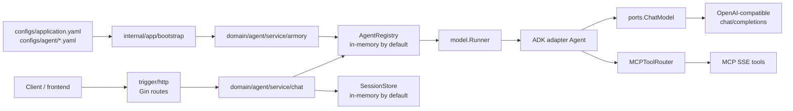
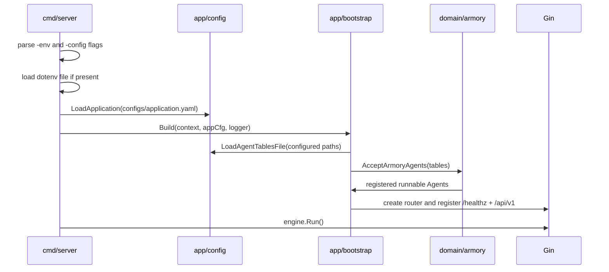
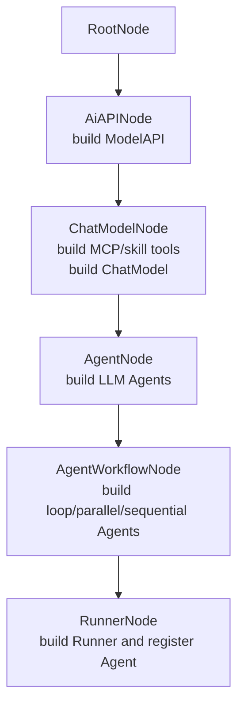
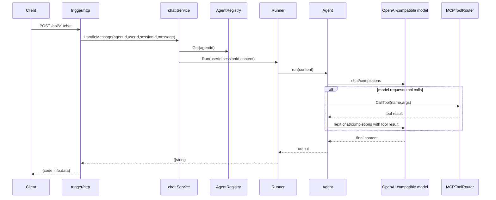

# AI Agent Scaffold Go

[](https://go.dev/)
[](https://gin-gonic.com/)
[](https://google.github.io/adk-docs/)
[](https://github.com/cloudwego/eino)
[](https://gorm.io/)
[](https://redis.io/)
[](https://nextjs.org/)

AI Agent Scaffold Go 是一个面向 Agent 应用开发的 Go 脚手架，围绕 Gin、Eino、Google ADK Go、GORM、MySQL、Redis 构建，重点提供清晰的 DDD 分层、配置驱动的 Agent 装配、多 Agent 工作流编排和 HTTP 运行时接口。仓库同时附带一个基于 Next.js 的 `frontend/` 子项目，作为对接后端 API 的示例前端，这个场景是通过drawio组件搭建的，旨在通过多轮对话来画出理想中的流程图。

## 目录

- [核心能力](#核心能力)
- [技术栈](#技术栈)
- [项目结构](#项目结构)
- [后端架构](#后端架构)
- [启动流程](#启动流程)
- [Armory 装配流程](#armory-装配流程)
- [运行时对话流程](#运行时对话流程)
- [快速开始](#快速开始)
- [配置说明](#配置说明)
- [HTTP API](#http-api)
- [前端启动](#前端启动)
- [开发与验证](#开发与验证)
- [联系作者](#联系作者)

## 项目展示


## 项目讲解文档

- 地址：[项目文档](https://my.feishu.cn/wiki/FbISwBnZPiGx0vkxyHFc8a1enig?fromScene=spaceOverview)
- 内容：简历写法、项目亮点与难点解析等

## 核心能力

- **配置驱动 Agent**：通过 `configs/agent/*.yaml` 声明模型 API、ChatModel、MCP 工具、skills、LLM Agent、workflow Agent 和 Runner。
- **Armory 装配链**：按 `Root -> AiAPI -> ChatModel -> Agent -> AgentWorkflow -> Runner` 的顺序装配运行时对象。
- **多 Agent 工作流**：支持 `loop`、`parallel`、`sequential` 三类 workflow Agent，串行工作流可通过 `output-key` 把上一步结果注入下一步指令。
- **HTTP 运行时接口**：提供 Agent 列表、创建会话、同步聊天、SSE 流式聊天接口。
- **OpenAI-compatible 模型调用**：基础设施层直接构造 Chat Completions 请求，支持普通响应和 `stream: true`。
- **MCP SSE 工具调用**：装配阶段注册 SSE MCP 工具，运行时在模型触发 tool call 后执行 JSON-RPC `tools/call`，再把工具结果回灌给模型。
- **Skill 资源扫描**：支持扫描 `SKILL.md`，把 skill 元数据转换为模型可见工具。
- **分层边界清晰**：领域层依赖本地 `ports`，避免直接耦合 Gin、GORM、Redis、模型 provider 和 ADK 实现。

## 技术栈

| 领域 | 选型 |
| --- | --- |
| 后端语言 | Go 1.25.6+ |
| HTTP 框架 | Gin |
| Agent 运行与插件 | Google ADK Go |
| 模型/工具抽象依赖 | Eino 相关依赖已纳入模块；当前模型调用由本地 OpenAI-compatible adapter 完成 |
| 配置 | YAML + dotenv + 环境变量占位符 |
| 模型协议 | OpenAI-compatible Chat Completions |
| 工具协议 | MCP SSE；stdio/local 配置结构已存在 |
| 持久化适配器 | GORM + MySQL，当前默认启动路径未强制启用 |
| 缓存适配器 | go-redis，当前默认启动路径未强制启用 |
| 日志 | zap + Gin logger |
| 前端 | Next.js 16 + React 19 + Tailwind CSS + react-drawio |

## 项目结构

```text
ai-agent-scaffold-go
├── cmd/server
│   └── main.go                         # 后端入口：加载 .env、读取配置、构建应用、启动 HTTP 服务
├── configs
│   ├── application.yaml                # 应用、端口、LLM 超时、Agent 配置路径、可选 DB/Redis 设置
│   └── agent
│       ├── only-one-agent.yaml         # 单 Agent 示例
│       ├── agent-draw-io.yaml          # draw.io 多 Agent 工作流示例
│       └── skills/                     # skill 资源，按 SKILL.md 扫描
├── deployments
│   ├── docker-compose.yml              # 本地 MySQL/Redis 参考服务
│   ├── mysql/my.cnf
│   └── redis/redis.conf
├── frontend                            # Next.js draw.io 示例前端
├── internal
│   ├── api
│   │   ├── dto                         # HTTP 请求/响应 DTO
│   │   └── response                    # code/info/data 统一响应封装
│   ├── app
│   │   ├── bootstrap                   # 应用装配：配置表加载、Armory、ChatService、Gin 路由
│   │   └── config                      # application.yaml 与 Agent YAML 加载/校验
│   ├── domain
│   │   ├── agent
│   │   │   ├── model                   # Agent 配置模型、聊天命令、Runner 接口
│   │   │   ├── ports                   # 模型、工具、Agent、Runner、Registry、SessionStore 端口
│   │   │   └── service
│   │   │       ├── armory              # Agent 装配领域服务与节点链
│   │   │       └── chat                # 会话解析与聊天运行时服务
│   │   └── shared/tree                 # 泛型策略树路由框架
│   ├── infrastructure
│   │   ├── adk                         # Agent/Runner/插件适配
│   │   ├── ai                          # OpenAI-compatible client、MCP SSE client、tool/skill 工厂
│   │   ├── cache                       # Redis client adapter
│   │   ├── logging                     # zap logger
│   │   └── persistence                 # MySQL/GORM adapter
│   └── trigger/http                    # Gin HTTP 入站路由
├── pkg/types                           # 应用错误码与 AppError
├── .env.example
├── go.mod
└── README.md
```

## 后端架构



后端按端口与适配器组织：

- `internal/domain` 定义核心模型、端口、Armory 装配和聊天服务。
- `internal/app/bootstrap` 负责把配置、领域服务、基础设施 adapter 和 Gin 路由连起来。
- `internal/infrastructure` 实现外部依赖适配，包括模型 client、MCP client、ADK Runner、Redis、MySQL 和日志。
- `internal/trigger/http` 只处理 HTTP 入参、出参和路由注册。
- `pkg/types` 提供跨层使用的错误码：`0000` 成功、`0001` 未知错误、`0002` 参数错误、`0003` Agent 不存在。

## 启动流程



入口文件是 `cmd/server/main.go`。默认行为：

- `-env` 默认读取 `.env`，也可通过 `APP_ENV_FILE` 指定；传空字符串可跳过 dotenv。
- `-config` 默认读取 `configs/application.yaml`，也可通过 `APP_CONFIG` 指定。
- dotenv 中的变量会进入进程环境，Agent YAML 里的 `${VAR}` 和 `${VAR:-default}` 会在加载时展开。
- `configs/application.yaml` 负责声明服务地址、LLM 请求超时、Agent 配置文件路径，以及当前可选的 MySQL/Redis 设置。
- `bootstrap.Build` 会装配 Agent、创建 `ChatService`、注册 Gin 路由并返回可运行的 `Engine`。

## Armory 装配流程

Armory 是 Agent 配置到运行时对象的装配链。每个 Agent table 都会使用新的 `DynamicContext`，按节点顺序构建和传递装配状态。



关键文件：

- `internal/domain/agent/service/armory/factory/factory.go`：组合完整节点链。
- `internal/domain/agent/service/armory/context.go`：保存 ModelAPI、ChatModel、已构建 Agent、当前 workflow 进度和临时值。
- `internal/domain/agent/service/armory/chat_model_node.go`：构建 MCP 工具、skill 工具和 ChatModel。
- `internal/domain/agent/service/armory/workflow/*.go`：按 `loop`、`parallel`、`sequential` 构建 workflow Agent。
- `internal/domain/agent/service/armory/runner_node.go`：根据 `runner.agent-name` 找到入口 Agent，创建 Runner 并注册到 `AgentRegistry`。

Workflow 行为：

- `sequential`：按配置顺序执行子 Agent，并用子 Agent 的 `output-key` 保存中间结果，后续 Agent 指令可用 `{output_key}` 引用。
- `loop`：当前 adapter 中按 fan-out 方式执行配置的子 Agent；配置里保留 `max-iterations` 字段。
- `parallel`：当前 adapter 中按 fan-out 方式聚合子 Agent 输出。

## 运行时对话流程



同步聊天走 `Runner.Run`，流式聊天走 `Runner.Stream`。LLM Agent 最多允许 4 轮 tool-call 循环，避免工具调用无限递归。

## 快速开始

### 环境要求

- Go 1.25.6+
- Node.js 18+ 和 npm，仅启动 `frontend/` 时需要
- Docker，可选，仅在本地启动 MySQL/Redis 参考服务时需要
- 一个 OpenAI-compatible Chat Completions 服务
- 如果启用示例里的百度搜索 MCP，还需要可访问的 MCP SSE endpoint

### 1. 安装依赖并编译

```bash
cd ai-agent-scaffold-go
go mod tidy
go build ./...
```

### 2. 准备环境变量

复制示例文件：

```bash
cp .env.example .env
```

至少替换以下变量为自己的真实值：

```dotenv
OPENAI_BASE_URL=https://api.example.com/
OPENAI_API_KEY=replace-with-your-key
BAIDU_SEARCH_MCP_BASE_URI=http://example.com/mcp/
BAIDU_SEARCH_MCP_SSE_ENDPOINT=sse?api_key=replace-with-your-key
```

`configs/agent/*.yaml` 会读取这些变量来构建模型和 MCP 工具。

### 3. 可选：启动本地 MySQL/Redis

当前默认后端启动路径使用内存态 Agent registry 和 session store；MySQL/Redis 适配器已经存在，但不是默认启动的硬依赖。需要本地服务时可以使用：

```bash
docker compose -f deployments/docker-compose.yml up -d
```

参考端口：

- MySQL：`127.0.0.1:13306`
- Redis：`127.0.0.1:16379`

### 4. 启动后端

```bash
go run ./cmd/server
```

也可以显式指定文件：

```bash
go run ./cmd/server -env .env -config configs/application.yaml
```

默认监听地址来自 `configs/application.yaml`：

```text
:8091
```

健康检查：

```bash
curl http://localhost:8091/healthz
```

预期响应：

```json
{"status":"ok"}
```

## 配置说明

### 应用配置

`configs/application.yaml` 控制应用启动参数：

```yaml
app:
  name: ai-agent-scaffold-go
  env: local
server:
  addr: ":8091"
database:
  required: false
  dsn: "root:<password>@tcp(127.0.0.1:13306)/ai-agent-scaffold-go?charset=utf8mb4&parseTime=True&loc=Local"
redis:
  required: false
  addr: "127.0.0.1:16379"
  password: ""
  db: 0
llm:
  request-timeout: 5m
agent:
  config-paths:
    - configs/agent/only-one-agent.yaml
    - configs/agent/agent-draw-io.yaml
```

说明：

- `server.addr` 是 Gin 监听地址。
- `llm.request-timeout` 使用 Go `time.ParseDuration` 格式，例如 `30s`、`5m`、`1h`。
- `agent.config-paths` 可配置多个 Agent YAML，启动时会合并所有 tables。
- `database` 和 `redis` 设置目前主要对应基础设施 adapter；默认 bootstrap 没有强制打开它们。

### Agent 配置

Agent 配置文件结构位于 `configs/agent/*.yaml`：

```yaml
ai:
  agent:
    config:
      tables:
        testAgent03:
          app-name: testAgent03
          agent:
            agent-id: "100003"
            agent-name: "single agent"
            agent-desc: "single agent demo"
          module:
            ai-api:
              base-url: ${OPENAI_BASE_URL}
              api-key: ${OPENAI_API_KEY}
              completions-path: "v1/chat/completions"
              embeddings-path: "v1/embeddings"
            chat-model:
              model: "gpt-5.5"
              tool-mcp-list:
                - sse:
                    name: baidu-search
                    base-uri: ${BAIDU_SEARCH_MCP_BASE_URI}
                    sse-endpoint: ${BAIDU_SEARCH_MCP_SSE_ENDPOINT}
                    request-timeout: 500000
              tool-skills-list:
                - type: "resource"
                  path: "agent/skills"
            agents:
              - name: "onlyAgent"
                description: "study plan helper"
                instruction: |
                  Build a beginner-friendly study plan from the user's request.
            runner:
              agent-name: "onlyAgent"
              plugin-name-list:
                - "myTestPlugin"
                - "myLogPlugin"
```

启动时会校验：

- `app-name`
- `agent.agent-id`
- `module.ai-api.base-url`
- `module.ai-api.api-key`
- `module.chat-model.model`
- `module.agents[].name`
- `module.agents[].instruction`
- `module.runner.agent-name`
- 每个 MCP tool 必须且只能声明 `local`、`sse`、`stdio` 之一
- workflow type 必须是 `loop`、`parallel` 或 `sequential`

默认值：

- `ai-api.completions-path` 默认 `v1/chat/completions`
- `ai-api.embeddings-path` 默认 `v1/embeddings`
- `tool-skills-list[].type` 默认 `directory`
- `agent-workflows[].max-iterations` 默认 `3`

## HTTP API

非流式接口统一返回：

```json
{
  "code": "0000",
  "info": "success",
  "data": {}
}
```

### GET /healthz

健康检查。

```bash
curl http://localhost:8091/healthz
```

```json
{"status":"ok"}
```

### GET /api/v1/query_ai_agent_config_list

查询已经注册的 Agent。

```bash
curl http://localhost:8091/api/v1/query_ai_agent_config_list
```

响应示例：

```json
{
  "code": "0000",
  "info": "success",
  "data": [
    {
      "agentId": "100003",
      "agentName": "single agent",
      "agentDesc": "single agent demo"
    }
  ]
}
```

### POST /api/v1/create_session

创建或复用某个 `userId + agentId` 的会话。

```bash
curl -X POST http://localhost:8091/api/v1/create_session \
  -H 'Content-Type: application/json' \
  -d '{"agentId":"100003","userId":"u1001"}'
```

响应示例：

```json
{
  "code": "0000",
  "info": "success",
  "data": {
    "sessionId": "testAgent03:u1001:1"
  }
}
```

同等 GET 形式：

```bash
curl 'http://localhost:8091/api/v1/create_session?agentId=100003&userId=u1001'
```

### POST /api/v1/chat

同步聊天。`sessionId` 可为空；为空时服务会自动创建或复用会话。

```bash
curl -X POST http://localhost:8091/api/v1/chat \
  -H 'Content-Type: application/json' \
  -d '{
    "agentId": "100003",
    "userId": "u1001",
    "sessionId": "",
    "message": "帮我制定一个 Go Agent 学习计划"
  }'
```

响应示例：

```json
{
  "code": "0000",
  "info": "success",
  "data": {
    "content": "..."
  }
}
```

### POST /api/v1/chat_stream

流式聊天，响应类型为 `text/event-stream`。

```bash
curl -N -X POST http://localhost:8091/api/v1/chat_stream \
  -H 'Content-Type: application/json' \
  -d '{
    "agentId": "100003",
    "userId": "u1001",
    "sessionId": "",
    "message": "继续细化第一周计划"
  }'
```

流式片段示例：

```text
event: message
data: 第一周可以从...

event: message
data: 接下来...
```

如果执行出错，服务会发送：

```text
event: error
data: <error message>
```

## 前端启动

`frontend/` 是一个 Next.js draw.io 示例前端，默认调用 `http://localhost:8091/api/v1`；启动方式是 `cd frontend && npm install && npm run dev`，然后访问 `http://localhost:3000`。

如需改后端地址，设置：

```bash
NEXT_PUBLIC_API_BASE_URL=http://localhost:8091/api/v1
```

## 开发与验证

后端常用命令：

```bash
go test ./...
go build ./...
```

检查 Go 文件是否需要格式化：

```bash
test -z "$(gofmt -l .)"
```

格式化：

```bash
gofmt -w .
```

前端常用命令：

```bash
cd frontend
npm run lint
npm run build
```

## 联系作者

- 邮箱：2465549609@qq.com
