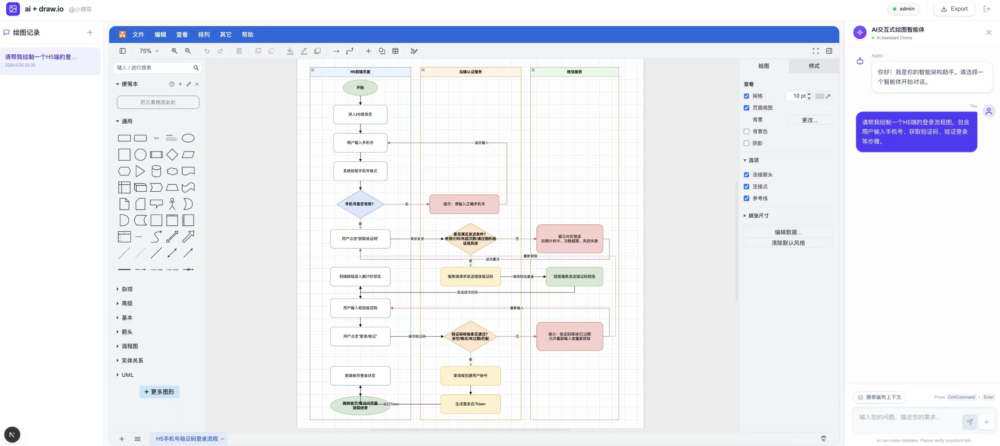
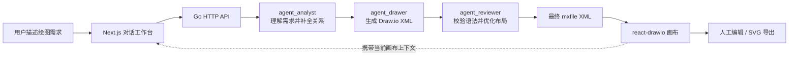
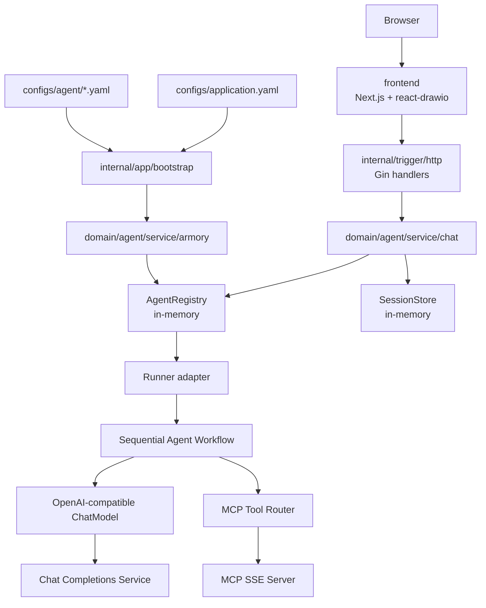
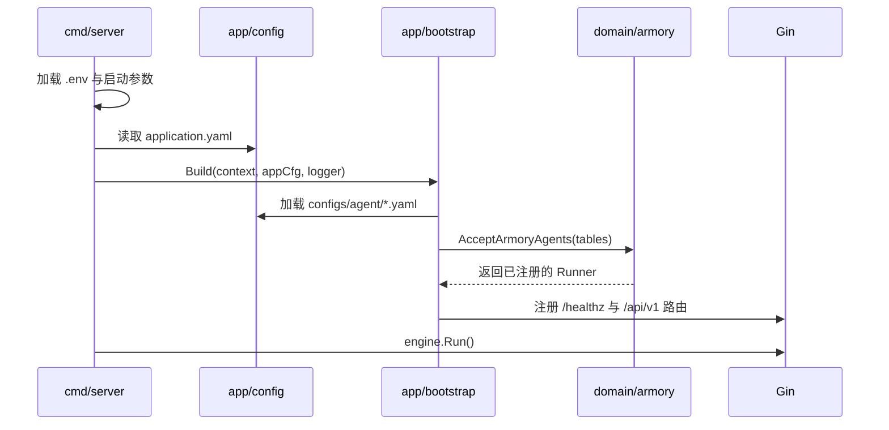
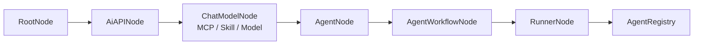

<div align="center">

# Drawio-Agent-Go

**基于 Go Agent 应用脚手架构建的 Draw.io 智能体，通过多轮对话绘制并持续优化理想中的架构图。**

[](https://go.dev/)
[](https://gin-gonic.com/)
[](https://nextjs.org/)
[](https://react.dev/)
[](https://www.drawio.com/)
[](https://platform.openai.com/docs/api-reference/chat)

[项目展示](#项目展示) · [项目讲解文档](#项目讲解文档) · [快速开始](#快速开始) · [工作原理](#工作原理) · [架构设计](#架构设计) · [HTTP API](#http-api)

</div>

## 项目简介

Drawio-Agent-Go 是一个基于 Agent 应用开发的 Go 脚手架搭建的 Draw.io 智能体，可通过多轮对话来绘制理想中的架构图。

用户只需要用自然语言描述想法，系统就会通过“需求分析、图形生成、结果检查”三个 Agent 协作，把需求转换为可编辑的 Draw.io XML，并在网页画布中直接渲染。开启“携带画布上下文”后，还可以继续通过对话调整节点、补充链路或优化布局。

## 项目展示

<p align="center">
  
</p>

前端工作台由三部分组成：左侧管理绘图记录，中间嵌入 Draw.io 画布，右侧通过 AI 对话生成或修改图表。

| 绘图记录 | Draw.io 画布 | AI 对话区 |
| --- | --- | --- |
| 创建、切换、重命名和删除会话 | 加载 Agent 生成的 XML，并支持手动编辑与自动保存 | 选择 Agent、输入绘图需求、携带当前画布上下文 |

可以从一段简单的自然语言开始：

```text
请绘制一个微服务电商系统架构图，包含 API Gateway、用户服务、
商品服务、订单服务、Redis、MySQL 和 Kafka，并标注主要调用关系。
```

生成初稿后，开启“携带画布上下文”，继续输入：

```text
在现有架构图中增加库存服务和支付服务，将异步事件统一接入 Kafka，
并调整布局，避免节点和连线重叠。
```

## 项目讲解文档

- 地址：[项目文档](https://my.feishu.cn/wiki/FbISwBnZPiGx0vkxyHFc8a1enig?fromScene=spaceOverview)
- 内容：简历写法、项目亮点与难点解析等

## 核心能力

| 能力 | 说明 |
| --- | --- |
| 自然语言绘图 | 将架构描述、业务流程或调用关系转换为合法的 Draw.io `mxfile` XML |
| 三 Agent 协作 | `agent_analyst` 分析需求，`agent_drawer` 生成图形，`agent_reviewer` 检查并优化结果 |
| 多轮迭代修改 | 前端可把当前画布 XML 随新指令一起提交，让 Agent 在已有图表基础上继续修改 |
| Draw.io 深度集成 | 基于 `react-drawio` 嵌入真实画布，支持手动编辑、自动保存和 SVG 导出 |
| 多会话绘图记录 | 浏览器本地保存聊天消息和图表 XML，支持创建、切换、重命名和删除绘图记录 |
| 配置驱动装配 | 通过 YAML 声明模型、Agent、Workflow、Runner、MCP 工具和 Skill 资源 |
| OpenAI-compatible | 模型层直接调用兼容 Chat Completions 的服务，方便对接不同模型提供方 |
| MCP 工具扩展 | 支持配置 SSE MCP 工具，在需求分析阶段按需检索和补充绘图信息 |
| Go 工程化分层 | 使用端口与适配器组织领域、应用、基础设施和 HTTP 入站层，便于替换外部依赖 |

> [!NOTE]
> 当前“多轮修改”主要由前端保存绘图记录，并在用户开启“携带画布上下文”后提交当前 XML 实现；它不是服务端长期记忆系统。

## 工作原理



### 三 Agent 分工

| Agent | 输入 | 职责 | 输出 |
| --- | --- | --- | --- |
| `agent_analyst` | 用户最新指令 | 判断图表类型，整理节点、关系、调用顺序和布局要求，必要时调用 MCP 工具 | `analysis_result` |
| `agent_drawer` | `analysis_result` | 生成包含 `mxfile`、`diagram`、`mxGraphModel` 和 `mxCell` 的 Draw.io XML | `draft_diagram` |
| `agent_reviewer` | `draft_diagram` | 检查标签、属性、节点引用和布局，修复错误并输出最终 XML | `final_result` |

默认 Runner 使用串行工作流 `sequential_draw_process`：

```text
agent_analyst -> agent_drawer -> agent_reviewer
```

仓库同时保留了 `loop` 和 `parallel` Workflow 的配置示例，便于继续实验循环优化和多方案生成。

## 快速开始

### 环境要求

- Go 1.25.6+
- Node.js 20+ 和 npm
- 一个 OpenAI-compatible Chat Completions 服务
- 可访问的 MCP SSE 服务；如果不使用 MCP，需要从启用的 Agent 配置中移除对应 `tool-mcp-list`
- Docker，可选，仅用于本地 MySQL/Redis 参考环境

### 1. 克隆项目

```bash
git clone https://github.com/peakxy/drawio-agent-go.git
cd drawio-agent-go
```

### 2. 安装后端依赖

```bash
go mod download
go build ./...
```

### 3. 准备环境变量

```bash
cp .env.example .env
```

至少需要替换以下配置：

```dotenv
OPENAI_BASE_URL=https://api.example.com/
OPENAI_API_KEY=replace-with-your-key

BAIDU_SEARCH_MCP_BASE_URI=https://example.com/mcp/
BAIDU_SEARCH_MCP_SSE_ENDPOINT=sse?api_key=replace-with-your-key
```

说明：

- `OPENAI_BASE_URL` 可以指向 OpenAI 官方服务或兼容 Chat Completions 的模型服务。
- 默认启用的 Agent YAML 声明了百度搜索 SSE MCP，因此需要提供可用的 MCP 地址。
- 如果暂时不需要 MCP，请从实际启用的 `configs/agent/*.yaml` 中移除 `tool-mcp-list`，不要保留空的 `base-uri`。
- `.env` 中的变量会在加载 Agent YAML 时展开，支持 `${VAR}` 和 `${VAR:-default}`。

### 4. 启动后端

```bash
go run ./cmd/server
```

也可以显式指定环境变量文件和应用配置：

```bash
go run ./cmd/server -env .env -config configs/application.yaml
```

默认监听 `:8091`，可以通过健康检查确认服务状态：

```bash
curl http://localhost:8091/healthz
```

```json
{"status":"ok"}
```

### 5. 启动前端

打开另一个终端：

```bash
cd frontend
npm ci
npm run dev
```

访问 [http://localhost:3000](http://localhost:3000)，演示账号和密码均为：

```text
admin / admin
```

登录后选择 **AI交互式绘图智能体**，输入绘图需求即可开始。

> [!IMPORTANT]
> `admin / admin` 只是前端演示登录，数据保存在浏览器 Cookie 中，不包含生产环境所需的服务端鉴权能力。

## 使用指南

### 创建一张新图

1. 点击左侧新增按钮创建绘图记录。
2. 在右侧选择“AI交互式绘图智能体”。
3. 描述图表类型、关键节点、节点关系和期望布局。
4. 等待三 Agent 工作流完成，最终 XML 会自动加载到中间画布。
5. 在 Draw.io 中继续手动编辑，或点击 `Export` 导出 SVG。

### 基于当前画布继续修改

1. 打开右侧输入框上方的“携带画布上下文”。
2. 输入新的修改指令，例如“增加 Redis 缓存层，并将所有缓存访问改为虚线”。
3. 前端会导出当前 Draw.io XML，并与新指令一起发送给 Agent。
4. Agent 返回新的 XML 后，前端更新当前画布和本地绘图记录。

### 管理绘图记录

- 单击左侧记录切换会话和画布。
- 双击记录名称进行重命名。
- 点击删除按钮移除记录。
- 聊天消息、后端会话 ID 和 Draw.io XML 会保存在浏览器 `localStorage`。

## 技术栈

| 领域 | 选型 |
| --- | --- |
| 后端语言 | Go 1.25.6+ |
| HTTP 框架 | Gin 1.12 |
| Agent 配置与装配 | YAML、Google ADK Go 插件接口、自定义 Runner/Agent adapter |
| 模型抽象 | Eino 相关依赖 + 本地 OpenAI-compatible adapter |
| 模型协议 | OpenAI-compatible Chat Completions |
| 工具协议 | MCP SSE；同时保留 local/stdio 配置结构 |
| 持久化适配器 | GORM + MySQL，可选，默认启动链路未启用 |
| 缓存适配器 | go-redis，可选，默认启动链路未启用 |
| 日志 | zap + Gin logger |
| 前端 | Next.js 16、React 19、Tailwind CSS 4、react-drawio 1.0.7 |

## 架构设计

### 整体架构



后端按端口与适配器组织：

- `internal/domain`：定义 Agent 配置模型、领域端口、Armory 装配和聊天服务。
- `internal/app`：加载应用配置并连接领域服务与基础设施。
- `internal/infrastructure`：实现模型、MCP、ADK、日志、MySQL 和 Redis adapter。
- `internal/trigger/http`：处理 Gin 路由、HTTP 参数和响应。
- `pkg/types`：提供应用错误码与统一错误类型。

<details>
<summary><strong>启动与装配流程</strong></summary>



`cmd/server/main.go` 支持：

- `-env`，默认 `.env`，也可以通过 `APP_ENV_FILE` 指定。
- `-config`，默认 `configs/application.yaml`，也可以通过 `APP_CONFIG` 指定。
- Agent YAML 中的环境变量占位符会在加载阶段展开。

</details>

<details>
<summary><strong>Armory 装配链</strong></summary>

Armory 负责把声明式 Agent 配置转换为运行时对象：



每个 Agent table 都使用独立的 `DynamicContext`，按节点顺序传递 Model API、ChatModel、Agent、Workflow 和 Runner 等装配结果。

</details>

### 项目结构

```text
drawio-agent-go
├── cmd/server/main.go                  # 后端入口
├── configs
│   ├── application.yaml               # 服务、LLM 超时和 Agent 配置路径
│   └── agent
│       ├── agent-draw-io.yaml          # Draw.io 三 Agent 工作流
│       ├── only-one-agent.yaml         # 单 Agent 示例
│       └── skills/                     # SKILL.md 资源示例
├── deployments                         # MySQL/Redis 参考环境
├── frontend                            # Next.js + react-drawio 前端
├── internal
│   ├── api                             # HTTP DTO 与统一响应
│   ├── app                             # 配置加载与应用 Bootstrap
│   ├── domain                          # Agent 领域模型、端口和服务
│   ├── infrastructure                  # 模型、MCP、ADK、DB、缓存和日志 adapter
│   └── trigger/http                    # Gin 路由与 Handler
├── pkg/types                           # 错误码与 AppError
├── .env.example
├── go.mod
└── README.md
```

> 仓库展示名称已经是 Drawio-Agent-Go；当前 Go module 和部分运行时配置仍保留 `ai-agent-scaffold-go`，因此代码导入路径不应直接按展示名称替换。

## 配置说明

### 应用配置

`configs/application.yaml` 控制服务地址、LLM 超时和需要装配的 Agent 文件：

```yaml
app:
  name: ai-agent-scaffold-go
  env: local

server:
  addr: ":8091"

llm:
  request-timeout: 5m

agent:
  config-paths:
    - configs/agent/only-one-agent.yaml
    - configs/agent/agent-draw-io.yaml
```

默认配置会同时注册单 Agent 示例和 Draw.io Agent。前端首次进入时不保证自动选中绘图 Agent，请手动选择 **AI交互式绘图智能体**。

MySQL 和 Redis adapter 已经存在，但默认 Bootstrap 使用内存态 `AgentRegistry` 和 `SessionStore`，启动本项目不强制依赖 MySQL 或 Redis。

### Draw.io Agent 配置

核心配置位于 `configs/agent/agent-draw-io.yaml`：

```yaml
ai:
  agent:
    config:
      tables:
        drawIoAgent:
          app-name: drawIoAgent
          agent:
            agent-id: "300000"
            agent-name: "AI交互式绘图智能体"
            agent-desc: "人 + AI + Draw.io，交互式对话完成 draw.io 绘图。"
          module:
            ai-api:
              base-url: ${OPENAI_BASE_URL}
              api-key: ${OPENAI_API_KEY}
              completions-path: v1/chat/completions
            chat-model:
              model: "gpt-5.5"
              tool-mcp-list:
                - sse:
                    name: baidu-search
                    base-uri: ${BAIDU_SEARCH_MCP_BASE_URI}
                    sse-endpoint: ${BAIDU_SEARCH_MCP_SSE_ENDPOINT}
              agents:
                - name: agent_analyst
                  output-key: analysis_result
                - name: agent_drawer
                  output-key: draft_diagram
                - name: agent_reviewer
                  output-key: final_result
              agent-workflows:
                - type: sequential
                  name: sequential_draw_process
                  sub-agents:
                    - agent_analyst
                    - agent_drawer
                    - agent_reviewer
              runner:
                agent-name: sequential_draw_process
```

完整的 Agent 指令、Workflow 示例和插件配置请直接查看 `configs/agent/agent-draw-io.yaml`。

## HTTP API

`/api/v1` 下的成功响应统一使用以下结构：

```json
{
  "code": "0000",
  "info": "success",
  "data": {}
}
```

| 方法 | 路径 | 用途 |
| --- | --- | --- |
| `GET` | `/healthz` | 服务健康检查 |
| `GET` | `/api/v1/query_ai_agent_config_list` | 查询已注册的 Agent |
| `POST / GET` | `/api/v1/create_session` | 为 `userId + agentId` 创建或复用会话 |
| `POST` | `/api/v1/chat` | 同步执行 Agent |
| `POST` | `/api/v1/chat_stream` | 以 SSE 形式返回 Runner 输出 |

### 查询 Agent

```bash
curl http://localhost:8091/api/v1/query_ai_agent_config_list
```

Draw.io Agent 的响应项类似：

```json
{
  "agentId": "300000",
  "agentName": "AI交互式绘图智能体",
  "agentDesc": "人 + AI + Draw.io，交互式对话完成 draw.io 绘图。"
}
```

### 创建会话

```bash
curl -X POST http://localhost:8091/api/v1/create_session \
  -H 'Content-Type: application/json' \
  -d '{"agentId":"300000","userId":"u1001"}'
```

```json
{
  "code": "0000",
  "info": "success",
  "data": {
    "sessionId": "drawIoAgent:u1001:1"
  }
}
```

### 生成 Draw.io 图表

`sessionId` 可以为空，服务会自动创建或复用会话：

```bash
curl -X POST http://localhost:8091/api/v1/chat \
  -H 'Content-Type: application/json' \
  -d '{
    "agentId": "300000",
    "userId": "u1001",
    "sessionId": "",
    "message": "绘制一个包含网关、用户服务、订单服务、Redis 和 MySQL 的微服务架构图"
  }'
```

响应中的 `content` 是可直接加载到 Draw.io 的 XML：

```json
{
  "code": "0000",
  "info": "success",
  "data": {
    "content": "<mxfile>...</mxfile>"
  }
}
```

### SSE 接口

```bash
curl -N -X POST http://localhost:8091/api/v1/chat_stream \
  -H 'Content-Type: application/json' \
  -d '{
    "agentId": "300000",
    "userId": "u1001",
    "sessionId": "",
    "message": "绘制一个用户登录时序图"
  }'
```

Draw.io Workflow 会先执行完整的分析、绘图和检查流程，再通过 SSE 返回 Runner 输出；当前实现不等同于逐 Token 实时绘图。

## 常见问题

### 为什么打开前端后没有自动选择 Draw.io Agent？

默认 `application.yaml` 同时加载了两份 Agent 配置，前端会选择列表中的第一个 Agent。请在右侧下拉框中手动选择“AI交互式绘图智能体”。

### 为什么后端启动时报 MCP 配置错误？

默认 Agent 配置声明了 SSE MCP 工具。请配置 `BAIDU_SEARCH_MCP_BASE_URI` 和 `BAIDU_SEARCH_MCP_SSE_ENDPOINT`，或者从启用的 Agent YAML 中移除 `tool-mcp-list`。

### 如何让 AI 修改现有图表，而不是重新生成？

打开“携带画布上下文”。前端会把当前 Draw.io XML 和新指令一起发送给 Agent，生成结果后覆盖当前画布。

### MySQL 和 Redis 是必需的吗？

不是。默认启动路径使用内存态 Registry 和 SessionStore；MySQL/GORM 与 Redis 目前主要作为脚手架中的可选基础设施 adapter。

### 前端绘图记录保存在哪里？

保存在浏览器 `localStorage`。清理浏览器站点数据后，本地绘图记录也会被删除。

## 开发与验证

后端：

```bash
go test ./...
go build ./...
test -z "$(gofmt -l .)"
```

前端：

```bash
cd frontend
npm run lint
npm run build
```

## 参与贡献

欢迎通过 Issue 提交问题或建议，也欢迎提交 Pull Request 改进 Agent 指令、绘图质量、前端交互或工程化能力。提交前请至少完成相关构建和测试命令。

## 联系作者

- 邮箱：xu1feng218@163.com
