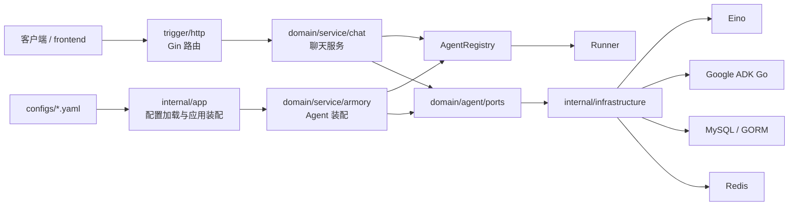
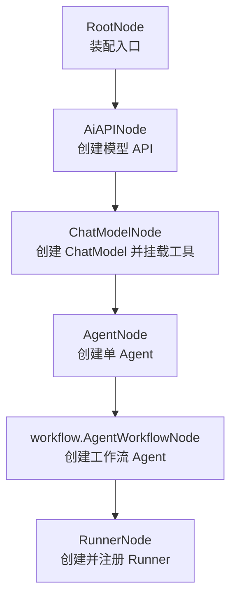

# AI Agent Scaffold Go

[](https://go.dev/)
[](https://gin-gonic.com/)
[](https://github.com/cloudwego/eino)
[](https://github.com/google/adk-go)
[](https://gorm.io/)
[](https://redis.io/)
[](https://nextjs.org/)

AI Agent Scaffold Go 是一个面向 Agent 应用开发的 Go 脚手架，围绕 Gin、Eino、Google ADK Go、GORM、MySQL、Redis 构建，重点提供清晰的 DDD 分层、配置驱动的 Agent 装配、多 Agent 工作流编排和 HTTP 运行时接口。仓库同时附带一个基于 Next.js 的 `frontend/` 子项目，作为对接后端 API 的示例前端，这个场景是通过drawio组件搭建的，旨在通过多轮对话来画出理想中的流程图。

这个项目适合作为 Agent 平台、智能助手后端、工作流 Agent 服务的起点。它把模型、工具、技能、Agent、Workflow、Runner 的装配逻辑收敛在领域层，通过端口隔离基础设施实现，让核心业务代码不直接依赖具体 SDK 或框架。

## 目录

- [核心特性](#核心特性)
- [技术栈](#技术栈)
- [项目结构](#项目结构)
- [架构设计](#架构设计)
- [Armory 装配流程](#armory-装配流程)
- [快速开始](#快速开始)
- [配置说明](#配置说明)
- [HTTP API](#http-api)
- [开发命令](#开发命令)
- [当前实现状态](#当前实现状态)
- [路线图](#路线图)
- [Star 趋势](#star-趋势)
- [许可证](#许可证)

## 核心特性

- **配置驱动 Agent**：通过 YAML 定义模型 API、ChatModel、工具、技能、单 Agent、Workflow 和 Runner。
- **多 Agent 工作流**：支持 `loop`、`parallel`、`sequential` 三类工作流 Agent 组装。
- **Armory 规则树装配**：使用 `Root -> AiApi -> ChatModel -> Agent -> AgentWorkflow -> Runner` 的显式节点链路构建运行时 Agent。
- **DDD 六层结构**：将 API 契约、应用启动、领域模型、触发器、基础设施和通用类型分离。
- **端口隔离基础设施**：领域层依赖本地 ports，不直接耦合 Gin、GORM、Redis、Eino、ADK Go 等实现细节。
- **HTTP 运行时接口**：提供查询 Agent、创建会话（POST/GET）、同步对话、流式对话四类接口。
- **本地开发资产**：包含示例配置、MySQL/Redis Docker Compose、环境变量模板和可一键启动的 Next.js 示例前端。

## 技术栈

| 领域 | 选型 |
| --- | --- |
| 后端语言 | Go 1.25.6+ |
| HTTP 框架 | Gin |
| Agent / 模型封装 | Eino |
| Agent 编排 | Google ADK Go |
| 持久化 | GORM + MySQL |
| 缓存 / 会话 | Redis |
| 配置 | YAML + 环境变量 |
| 日志 | zap |
| 前端 | Next.js + React + TailwindCSS |

## 项目结构

```text
ai-agent-scaffold-go
├── cmd/server                          # 服务入口，当前负责启动日志初始化
├── configs
│   ├── application.yaml                # 应用、服务端口、MySQL、Redis、Agent 配置入口
│   └── agent
│       ├── only-one-agent.yaml         # 单 Agent 示例配置（含 MCP 与 skills）
│       ├── agent-draw-io.yaml          # draw.io Agent 示例配置
│       └── skills/                     # 内置 skill 资源（battle-plan、pdf 等）
├── deployments
│   └── docker-compose.yml              # 本地 MySQL / Redis
├── frontend                            # Next.js 示例前端，调用后端 /api/v1
├── internal
│   ├── api                             # DTO 与统一响应封装
│   ├── app                             # 应用装配与配置加载边界
│   ├── domain
│   │   ├── agent
│   │   │   ├── model                   # Agent 配置、聊天命令、Runner 等领域模型
│   │   │   ├── ports                   # 模型、工具、Agent、Runner、Registry 等领域端口
│   │   │   └── service
│   │   │       ├── armory              # Agent 装配领域服务与核心节点
│   │   │       │   ├── factory         # 默认装配工厂
│   │   │       │   └── workflow        # loop / parallel / sequential 工作流节点
│   │   │       └── chat                # 会话与聊天运行时服务
│   │   └── shared/tree                 # 泛型策略树路由框架
│   ├── infrastructure                  # Eino、ADK、MySQL、Redis、日志等适配器
│   └── trigger/http                    # Gin HTTP 入站适配器
├── pkg/types                           # 响应码与应用错误
├── .env.example                        # 环境变量示例
├── go.mod
└── README.md
```

## 架构设计



### 分层边界

- `internal/api`：请求/响应 DTO 与统一响应结构。
- `internal/app`：应用启动、配置加载、服务装配边界。
- `internal/domain`：领域模型、端口、Armory 装配、聊天运行时、策略树框架。
- `internal/trigger`：HTTP 等入站触发器。
- `internal/infrastructure`：数据库、缓存、AI SDK、日志等外部依赖适配。
- `pkg/types`：跨层可复用的错误码和应用错误。

领域层保持稳定，不直接导入 Gin、GORM、Redis、Eino、ADK Go 或 provider-specific 的基础设施包。

## Armory 装配流程

Armory 是项目里的 Agent 装配链路。它接收 Agent 配置表，按节点顺序构建模型、工具、Agent、Workflow 和 Runner。



最新代码已经按职责拆分：

```text
internal/domain/agent/service/armory
├── root_node.go
├── ai_api_node.go
├── chat_model_node.go
├── agent_node.go
├── runner_node.go
├── factory/factory.go
└── workflow
    ├── agent_workflow_node.go
    ├── loop_node.go
    ├── parallel_node.go
    └── sequential_node.go
```

Workflow 支持三种编排方式：

- `loop`：循环执行子 Agent，支持最大迭代次数配置。
- `parallel`：并行组合多个子 Agent。
- `sequential`：按顺序串联单 Agent 或已装配的 Workflow Agent。

## 快速开始

### 环境要求

- Go 1.25.6+
- Node.js 18+ 与 npm（仅在启动 `frontend/` 时需要）
- Docker，可选，用于本地 MySQL / Redis

### 获取代码并编译

```bash
git clone <repo-url>
cd ai-agent-scaffold-go
go mod tidy
go build ./...
```

### 启动后端服务入口

```bash
go run ./cmd/server
```

当前 `cmd/server` 会完成日志初始化并输出启动日志。完整运行时装配、Armory 初始化、Gin 路由挂载等能力已经按包结构准备好，后续可以继续在入口层串接。

### 启动本地基础设施

```bash
docker compose -f deployments/docker-compose.yml up -d
```

默认端口：

- MySQL：`127.0.0.1:13306`
- Redis：`127.0.0.1:16379`

### 启动前端

仓库内置一个 Next.js 示例前端，默认调用后端 `http://localhost:8091/api/v1`。最小启动方式：

```bash
cd frontend
npm install
npm run dev
```

访问：

```text
http://localhost:3000
```

更多前端使用细节见 `frontend/README.md`。

## 配置说明

应用主配置：

```text
configs/application.yaml
```

Agent 示例配置：

```text
configs/agent/only-one-agent.yaml
configs/agent/agent-draw-io.yaml
```

环境变量示例：

```text
.env.example
```

`configs/application.yaml` 会声明服务端口、本地数据库、Redis 和 Agent 配置路径：

```yaml
app:
  name: ai-agent-scaffold-go
  env: local
server:
  addr: ":8091"
database:
  required: false
  dsn: "root:123456@tcp(127.0.0.1:13306)/ai_agent_scaffold_go?charset=utf8mb4&parseTime=True&loc=Local"
redis:
  required: false
  addr: "127.0.0.1:16379"
agent:
  config-paths:
    - configs/agent/only-one-agent.yaml
```

Agent 配置示例（节选自 `configs/agent/only-one-agent.yaml`）：

```yaml
ai:
  agent:
    config:
      tables:
        testAgent03:
          app-name: testAgent03
          agent:
            agent-id: "100003"
            agent-name: "single agent"
            agent-desc: "single agent demo"
          module:
            ai-api:
              base-url: "https://apis.itedus.cn"
              api-key: "${OPENAI_API_KEY}"
              completions-path: "v1/chat/completions"
              embeddings-path: "v1/embeddings"
            chat-model:
              model: "gpt-4.1"
              tool-mcp-list:
                - sse:
                    name: baidu-search
                    base-uri: http://appbuilder.baidu.com
                    sse-endpoint: /v2/ai_search/mcp/sse?api_key=${BAIDU_SEARCH_MCP_API_KEY}
                    request-timeout: 500000
              tool-skills-list:
                - type: "resource"
                  path: "agent/skills"
            agents:
              - name: "onlyAgent"
                description: "study plan helper"
                instruction: |
                  Build a beginner-friendly study plan from the user's request.
            runner:
              agent-name: "onlyAgent"
              plugin-name-list:
                - "myTestPlugin"
                - "myLogPlugin"
```

连接真实模型服务前，需要复制 `.env.example` 并设置真实的模型 API Key。

## HTTP API

基础路径：

```text
/api/v1
```

这些路由由 `internal/trigger/http/agent_handler.go` 中的 `RegisterAgentRoutes` 注册。当前服务入口还没有把 Gin 路由完整挂到 `cmd/server`，接入时可复用 `RegisterAgentRoutes(router, chatService)`。

### 查询 Agent 配置

```bash
curl http://localhost:8091/api/v1/query_ai_agent_config_list
```

### 创建会话

```bash
curl -X POST http://localhost:8091/api/v1/create_session \
  -H 'Content-Type: application/json' \
  -d '{"agentId":"100003","userId":"u1001"}'
```

也支持 GET：

```bash
curl 'http://localhost:8091/api/v1/create_session?agentId=100003&userId=u1001'
```

### 同步对话

```bash
curl -X POST http://localhost:8091/api/v1/chat \
  -H 'Content-Type: application/json' \
  -d '{"agentId":"100003","userId":"u1001","message":"帮我制定一个学习计划"}'
```

### 流式对话

`/chat_stream` 通过 SSE（`text/event-stream`）推送结果，每个分片以 `event: message` 形式发送，错误以 `event: error` 结束。

```bash
curl -N -X POST http://localhost:8091/api/v1/chat_stream \
  -H 'Content-Type: application/json' \
  -d '{"agentId":"100003","userId":"u1001","sessionId":"session-u1001","message":"继续"}'
```

## 开发命令

格式化：

```bash
gofmt -w .
```

编译：

```bash
go build ./...
```

启动前端开发服务器：

```bash
cd frontend && npm run dev
```

## 当前实现状态

- DDD 包结构、领域模型、端口、策略树和 Armory 装配链路已经建立。
- Armory 核心节点、工厂、Workflow 节点已按职责拆分。
- ChatService、AgentRegistry、SessionStore 和 HTTP 路由边界已在代码结构中分离。
- Eino、ADK Go、GORM、Redis、zap 等依赖已经纳入模块，并通过本地端口和基础设施包隔离。
- `cmd/server` 已串接配置加载、Armory 装配、Gin 路由和插件链路，启动后即对外提供 `/api/v1` 接口。
- Runner 已接入真实 OpenAI 兼容 ChatModel：`/api/v1/chat` 调 `chat/completions` 同步接口，`/api/v1/chat_stream` 走 `stream: true` SSE 推送 delta。
- SSE MCP 客户端可用：装配阶段连接 `tool-mcp-list[].sse`，运行时模型选中工具后真正发起 JSON-RPC `tools/call` 并把结果回灌给下一轮模型请求，工具调用循环上限为 4 轮。
- Local MCP、stdio MCP 仍返回 unsupported 错误；Skill 工具当前只向模型暴露名字，不参与执行。
- `frontend/` 提供基于 Next.js 的 draw.io 示例前端，默认对接后端 `/api/v1`。

## 路线图

- 接入更稳定的模型 backoff / 重试与请求级超时控制。
- 补齐 stdio MCP 客户端实现，扩展 local MCP 真实执行入口。
- 让 Skill 工具具备运行时调用能力，并把 skill 元数据注入模型 tool schema。
- 增加基于 MySQL 的 Agent 配置仓储。
- 增加基于 Redis 的分布式会话存储。
- 增加请求追踪、Token 用量、Agent Workflow 事件等可观测能力。

## Star 趋势

[](https://star-history.com/#peakxy/ai-agent-scaffold-go&Date)

## 许可证

## 联系方式

- 邮箱: 2465549609@qq.com
